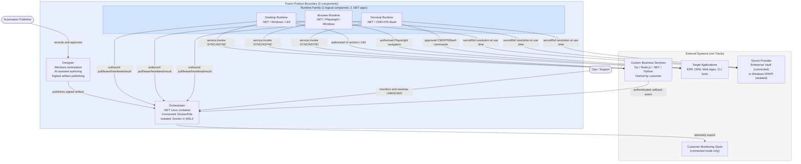
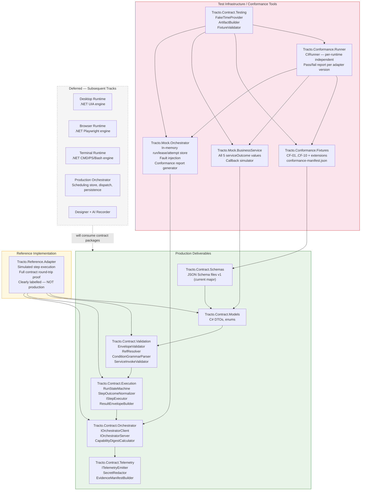
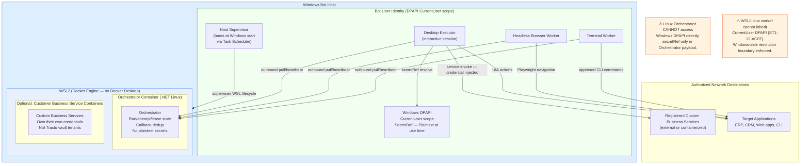
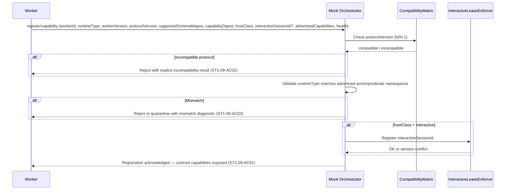
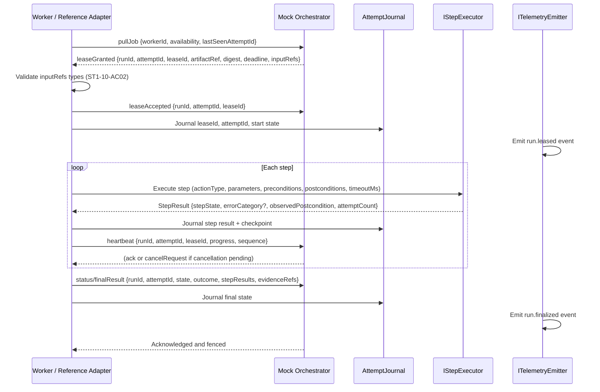

# 06 — Architectural and Sequence Diagrams

All diagrams are in Mermaid source. Render with any Mermaid-compatible viewer.

---

## A. System Context



**Key boundaries:**
- Runtimes only make outbound connections (pull/heartbeat direction). No inbound listener.
- Business services are never inside the Tracto product boundary.
- Secret plaintext never crosses to Linux Orchestrator (Windows-side resolution only).
- Authenticated business callbacks reach Orchestrator; they cannot name continuation scripts.

---

## B. Stage 1 Component Design



---

## C. Deployment Boundaries



**Deployment questions left open by source documents (as noted at ST1-12-AC07):**
- The mechanism by which a Windows-side authorized Runtime process mediates secret resolution for any Linux-hosted worker component is not defined in v1.2A beyond the principle ("approved Windows-side resolution/execution boundary"). This is a deployment PoC concern (POC-05), not a Stage 1 contract concern. The shared contract simply enforces that the Linux Orchestrator receives only `secretRef`.

---

## D1. Script Loading, Trust Verification and Validation

```mermaid
sequenceDiagram
    participant P as Publisher
    participant R as Artifact Registry (Orchestrator)
    participant W as Worker / Reference Adapter
    participant V as EnvelopeValidator
    participant T as ArtifactTrustVerifier

    P->>R: Publish signed automation artifact (schemaVersion, automationId, runtimeType, steps, digest, signer)
    R->>T: Verify signer trust + digest
    T-->>R: Trust result (trusted | rejected)
    alt Untrusted or tampered
        R-->>P: Reject atomically — no artifact stored (ST1-01-AC04)
    end
    R->>V: Validate envelope schema, runtimeType, policyRefs, automationId format
    V-->>R: VALID or VALIDATION failure with field path + detail code
    alt VALIDATION failure
        R-->>P: Reject with errorCategory=VALIDATION (ST1-01-AC02, ST1-01-AC08)
    end
    R-->>P: Artifact accepted; immutable version pinned

    Note over W: On lease acquisition
    W->>R: Fetch artifact by immutable ref
    R-->>W: Artifact + digest
    W->>T: Re-verify digest before execution
    T-->>W: Verified or POLICY_DENIED
    W->>V: Validate against current or previous major schema (N/N-1)
    V-->>W: VALID or VALIDATION
    alt Incompatible schema major
        W-->>W: Reject: republish diagnostic (ST1-01-AC05)
    end
    Note over W: Validation complete — execution may begin
```

---

## D2. Worker Registration and Capability Compatibility



---

## D3. Job Acquisition, Lease, Input Resolution and Execution Reporting



---

## D4. Synchronous Custom-Service Invocation

```mermaid
sequenceDiagram
    participant W as Worker
    participant SV as ServiceInvokeValidator
    participant SR as IServiceRegistry
    participant DP as Windows-side SecretProvider
    participant BIZ as Fake/Real Business Service

    W->>SV: Validate service.invoke {serviceRef, operationRef, mode=SYNC, inputBindings, authSecretRef?, idempotencyKeyRef?}
    SV->>SR: Lookup serviceRef + operationRef
    SR-->>SV: Approved route, TLS/auth policy, optional response schema version
    alt Not in registry
        SV-->>W: Reject POLICY_DENIED — no network connection (ST1-06-AC02)
    end
    SV-->>W: Validated

    opt authSecretRef present
        W->>DP: Resolve secretRef (Windows side only)
        DP-->>W: Plaintext credential (never to Orchestrator or logs)
    end

    W->>BIZ: HTTP POST to registered endpoint (with credential, idempotencyKey, correlationId)
    BIZ-->>W: Response {serviceOutcome, businessOutcome?, actionCode?, data?, businessJobId?, correlationId}

    alt serviceOutcome = SUCCESS
        W->>W: Bind approved fields; no domain decision inferred (ST1-06-AC04)
    else serviceOutcome = BUSINESS_REJECTION
        W->>W: Record businessOutcome=REJECTED; follow allowlisted UI branch (ST1-06-AC05)
    else serviceOutcome = TRANSIENT_FAILURE and idempotent
        W->>W: Bounded retry with same idempotencyKey (ST1-06-AC07)
    else serviceOutcome = UNKNOWN_OUTCOME
        W->>W: Do NOT retry; run → UNKNOWN with needsAttention (C3 / ST1-06-AC06)
    end

    Note over W: Response schema mismatch → serviceOutcome=TECHNICAL_FAILURE\nerrorCategory=VALIDATION, detail=service.responseSchemaMismatch
```

---

## D5. Asynchronous Handoff and Callback-Driven Continuation

```mermaid
sequenceDiagram
    participant W as Worker (Run A)
    participant ORC as Mock Orchestrator
    participant BIZ as Business Service
    participant CB as Callback Boundary

    W->>BIZ: service.invoke mode=ASYNC {correlationId, idempotencyKey}
    BIZ-->>W: Accepted + businessJobId
    W->>W: Record HANDED_OFF + businessJobId
    W->>ORC: finalResult {state=HANDED_OFF, businessJobId, correlationId}
    ORC-->>W: Acknowledged; worker lease released (ST1-07-AC01)

    Note over BIZ: Business processing proceeds independently
    BIZ->>CB: Authenticated callback {eventId, eventType, businessJobId, correlationId, resultRef, signature, keyId, timestamp, nonce}

    CB->>CB: Verify signature + timestamp + nonce (not self-asserted authenticated:true) (ST1-07-AC04)
    alt Invalid/stale/replayed
        CB->>CB: Reject event
    end

    CB->>ORC: Validated callback
    ORC->>ORC: Dedup by eventId (ST1-07-AC05)
    alt Duplicate eventId
        ORC->>ORC: Log; emit zero new runs
    end

    ORC->>ORC: Lookup correlation → internal continuation rule (no script named by service) (ST1-07-AC06)
    ORC->>ORC: Create Run B (target automation from Orchestrator config; dedup by sourceRunId + ruleId) (ST1-07-AC08)

    Note over ORC: Run B dispatched independently to next available worker
```

---

## D6. Successful Technical Completion and Static Continuation

```mermaid
sequenceDiagram
    participant W as Worker (Run A)
    participant ORC as Mock Orchestrator

    W->>ORC: finalResult {state=SUCCEEDED, businessOutcome?, stepResults, evidenceRefs}
    ORC->>ORC: Verify attempt identity; fence duplicates
    ORC->>ORC: Check for Orchestrator-owned on-SUCCEEDED static continuation rule
    Note over ORC: Continuation target is internal config — not from script or service
    alt Rule found and not already triggered for this runId + ruleId
        ORC->>ORC: Create exactly one Run B
        Note over ORC: Run B has its own runId, attemptId; tracked independently (ST1-07-AC08)
    end
    ORC-->>W: Acknowledged
```

---

## D7. Cancellation, Lease Expiry, Uncertain Commitment and Reconciliation

```mermaid
sequenceDiagram
    participant W as Worker
    participant ORC as Mock Orchestrator
    participant J as AttemptJournal

    Note over W,ORC: Scenario 1 — Cancellation during active work

    W->>ORC: heartbeat {sequence N}
    ORC-->>W: cancelRequest {runId, attemptId, reason}
    W->>W: Observe cancel at next safe boundary (wait/repeat)
    W->>W: Bound cleanup; determine if irreversible action committed
    alt No irreversible action committed
        W->>ORC: finalResult {state=CANCELLED} (ST1-11-AC02)
    else Irreversible action committed but unconfirmed
        W->>ORC: finalResult {state=UNKNOWN, needsAttention=true, unknownReason} (ST1-11-AC03)
    end
    W->>J: Journal final state + step evidence

    Note over W,ORC: Scenario 2 — Lease expiry

    ORC->>ORC: Lease deadline exceeded; no heartbeat received
    ORC->>ORC: Flag attempt for reconciliation; do NOT dispatch replacement blindly (ST1-10-AC05)

    W->>ORC: reconcile {runId, attemptId, lastSeenAttemptId, journalCheckpoint}
    ORC->>J: Compare persisted identity with reconcile request
    alt Proof of non-start or safe non-commit
        ORC-->>W: Safe requeue decision
    else Cannot rule out commitment
        ORC->>ORC: Finalize UNKNOWN + needsAttention; fence attempt
        ORC-->>W: UNKNOWN resolution (ST1-14-AC03)
    end

    Note over W,ORC: Scenario 3 — Stale attempt reporting

    W->>ORC: finalResult from OLD attempt after replacement assigned
    ORC->>ORC: Fencing check: attemptId is stale (newer attemptId exists)
    ORC->>ORC: Discard stale result; do NOT overwrite authoritative state (ST1-10-AC06)
```
